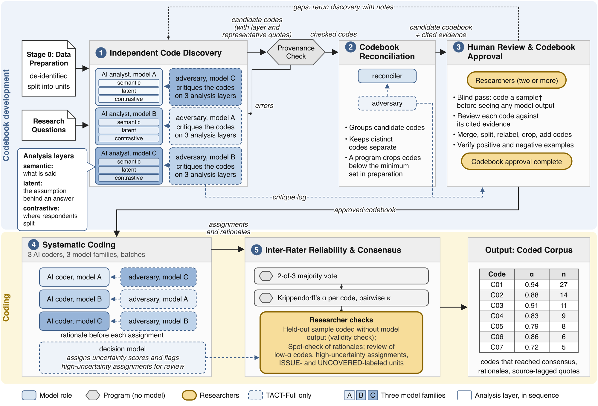

# TACT: Traceable AI Council for Thematic analysis

A bounded AI council procedure that enables teams
to analyze qualitative data at scale with guardrails while keeping interpretation and discernment with
humans. In TACT, **AI models** discover and apply patterns in the data, **deterministic programs**
(scripts) check the provenance of cited evidence, and **researchers** retain the interpretive
decisions. The council uses models from three frontier model families (Anthropic's Claude, Google's
Gemini and OpenAI's GPT), so that no single model family's blind spots or biases dominate the analysis.
TACT comes in two variants: **TACT-Lite**, the core AI council procedure, and **TACT-Full**, which adds
adversaries (models from other model families that critique each model's output) and a decision model
that surfaces high-uncertainty code assignments.

This repository holds everything the paper *TACT: A Pragmatic Approach to Qualitative Analysis with an AI Council* releases: the prompts, the scripts for every stage, the
validation corpus with its mapping, scoring and reliability scripts, and the paper's supplement
([SUPPLEMENT.md](SUPPLEMENT.md)).



*The TACT procedure. Dashed boxes are TACT-Full only.*

## The procedure

Each model receives only the inputs it needs, and models performing the same task do so independently,
without seeing each other's output. Stages 1 to 3 develop the codebook; Stages 4 and 5 apply it.

**Stage 0: Data preparation.** *Researchers* decide which model providers may receive the data and
how much it must be de-identified, and fix the analysis thresholds: the minimum number of distinct
respondents whose responses must support a code, and the minimum agreement among the AI coders on
each code, measured with Krippendorff's alpha. A code whose alpha falls below the threshold returns to
the researchers, who either refine its definition and have the AI coders recode it, drop the code, or
keep it with a stated reason,
and report the decision. For TACT-Full, they also fix the decision model's thresholds. They state each
research question and what they want to learn from it in the prompts. *A program* then splits the
corpus into units, de-identifies them and gives each a unique identifier, attaches each respondent's
other answers as context (seen by models, never coded), and draws two separate random samples,
stratified by question, that researchers code without seeing any model output: the **blind-pass
sample** and the **held-out sample**.

**Stage 1: Independent code discovery.** *Three AI analysts*, one from each model family,
independently analyze the whole corpus at three **analysis layers** per research question: semantic
(what respondents say at face value), latent (the assumptions or ways of working behind answers) and
contrastive (where answers diverge from the respondent's overall stance). For each code, an AI analyst
gives a short label, a definition in respondents' own terms, inclusion and exclusion rules, positive
and negative examples, the units that support it and **representative quotes** from at least three of
them; units no code fits are listed as having no code. The **provenance check**, a deterministic
program, confirms that every cited unit and quote exists in the corpus and that no unit was skipped,
and returns any failure to the AI analyst for correction. *TACT-Full:* a **discovery adversary** from
another model family critiques each AI analyst's codes at each analysis layer; the AI analyst accepts,
partly accepts or rejects each critique with a reason and revises its codes, and a critique log records
both. A code the adversary found but the AI analyst did not adopt stays marked as the adversary's.

**Stage 2: Codebook reconciliation.** *A program* builds the **overlap table**: for each pair of codes
from different AI analysts, the units both cite, their Jaccard similarity and their overlap
coefficient. *One reconciler* reads it with each code's definition and quotes and proposes a **merge
plan** that groups codes that share units and describe the same thing within one research question,
with a rationale for each group. *A program* then drops codes supported by fewer respondents than the
minimum and lists them, so that researchers can restore weakly substantiated codes they consider
important. *TACT-Full:* a **reconciliation adversary** critiques the merge plan (merges that should stay
apart, codes that should be merged, dropped codes that have support), and the reconciler answers each
critique and revises the plan.

**Stage 3: Human review and codebook approval.** *Researchers* first open-code the blind-pass sample
without seeing any model output, then compare their codes with the candidate codebook. They review
each code's label, evidence and definition; split, merge, relabel, move, drop, restore or add codes,
settling differences by negotiated agreement and recording each decision in a review log; verify and
refine the positive and negative examples; and approve the codebook. In TACT-Full they also read the
critique logs. If no candidate code fills a gap they found, they rerun discovery with notes on the
missing codes. Researchers who already have a codebook can go from Stage 0 directly to Stage 4.

**Stage 4: Systematic coding.** *Three AI coders*, one per model family, independently code every
unit in batches. Each gives a rationale, citing the relevant part of the unit, before it assigns a
code. AI coders may assign several codes but cannot add codes outside the codebook; a unit no code
fits is coded `UNCOVERED`, and a unit with a data problem is coded `ISSUE`. *TACT-Full:* a **coding
adversary** critiques each AI coder's assignments and the AI coder answers and revises; and a
**decision model** (TypeSafe's Jev) scores how likely each code is to apply to each unit. Before
coding, each AI coder sees only the codes likely to apply (screening); after coding, consensus
assignments the decision model scored below the threshold are flagged as **high-uncertainty
assignments** for the researchers.

**Stage 5: Inter-rater reliability and consensus.** *A program* settles each unit's codes by majority
vote (a code that at least two of the three AI coders assign **reaches consensus**; units that at least
two code `ISSUE` are excluded from prevalence counts), computes Krippendorff's alpha per code with its
median, minimum and maximum, and pairwise Cohen's kappa between AI coders. Codes below the alpha
threshold go back to the researchers with the units on which the AI coders disagreed. *Researchers*
code the held-out sample without seeing the consensus coding, resolve their differences and compare
their coding with the council's (**human-council agreement**, Cohen's kappa); spot-check a random
sample of rationales; and review the `ISSUE` and `UNCOVERED` units and, in TACT-Full, the
high-uncertainty assignments.

**Output: the coded corpus.** The approved codebook, and every unit tagged with the codes that reached
consensus, the AI coders' rationales and the representative quotes, so that each tag can be traced
back to the respondent.

| | TACT-Lite | TACT-Full adds |
|---|---|---|
| Stage 1 | three AI analysts, provenance check | discovery adversaries and critique logs |
| Stage 2 | reconciler, overlap table, minimum-respondents rule | reconciliation adversary |
| Stage 3 | blind pass, human review, approval | review of the critique logs |
| Stage 4 | three AI coders, rationale first | screening by the decision model; coding adversaries |
| Stage 5 | consensus, alpha, kappa, human-council agreement, spot-check | high-uncertainty assignments |

## Defaults

The researchers fix these in Stage 0, before any model runs (`config.example.yaml`).

| Setting | Default | Where it acts |
|---|---|---|
| Minimum respondents per code | 3 distinct respondents | Stage 2: a program drops codes with fewer and lists them for human review |
| Krippendorff's alpha threshold | 0.7 (raise it, e.g. to 0.8, for conservative conclusions) | Stage 5: codes below it return to the researchers, who refine and recode, drop, or keep with a stated reason |
| Batch size | 25 units (20 to 50 recommended) | Stage 4: units per AI coder call |
| Consensus | 2 of 3 AI coders | Stage 5: a code that reaches it on a unit enters the coded corpus |
| Blind-pass sample | 10% of units, at least 50 and at most 150, stratified by question | Stage 3: coded by at least two researchers before any model output |
| Held-out sample | at least 10% of units, stratified by question | Stage 5: coded by at least two researchers without the council's coding |
| TACT-Full: screening | score at least 0.10, plus the top 5 codes | Stage 4: the codes each AI coder sees for a unit |
| TACT-Full: screening audit | 5% of screened-out (unit, code) pairs | Stage 4: shown anyway, at random, so that codes screening hid can be checked |
| TACT-Full: high-uncertainty assignment | screening score below 0.25 | Stage 5: consensus assignments flagged for the researchers' review |

## Quickstart 1: your own data

1. **Connect your models.** [SETUP.md](SETUP.md) shows how to reach three model families (a CLI login
   or an API key in an environment variable each) and, for TACT-Full, the decision model. The config
   names the environment variable; it never holds a key.
2. **Configure the study.** Copy `config.example.yaml` to `config.yaml` and set the variant (`mode:
   lite` or `full`), the corpus (a de-identified CSV with columns `uid,text`; optional `context`,
   `respondent`, `question`, `stratum`), the research questions, the model families, and
   `data_governance` (what leaves your computer, to which model providers, under which terms).
3. **Run the stages.** Every model step skips work whose output exists, so a run can resume after an
   interruption; `status` prints what is done and what is next.

```bash
python3 pipeline/council.py --config config.yaml doctor           # what is ready, what is missing
python3 pipeline/council.py --config config.yaml prepare          # Stage 0: units, context, the two samples
python3 pipeline/human.py   --config config.yaml blind-pass       # RESEARCHERS: open-code before any model output
python3 pipeline/run.py     --config config.yaml discovery        # Stage 1 with the provenance check
python3 pipeline/run.py     --config config.yaml discovery-adversary   # TACT-Full only
python3 pipeline/run.py     --config config.yaml reconcile        # Stage 2 -> the candidate codebook
python3 pipeline/human.py   --config config.yaml review-dashboard # RESEARCHERS: Stage 3 human review
python3 pipeline/human.py   --config config.yaml review-to-edits review_A.json review_B.json
#   the researchers agree codebooks/review_edits.json
python3 pipeline/council.py --config config.yaml approve          # the approved codebook
python3 pipeline/human.py   --config config.yaml heldout-packet   # RESEARCHERS: code the held-out sample
python3 pipeline/run.py     --config config.yaml code             # Stage 4, then Stage 5 consensus and reliability
python3 pipeline/human.py   --config config.yaml spot-check       # RESEARCHERS: rationales, ISSUE, UNCOVERED, high-uncertainty
python3 pipeline/human.py   --config config.yaml low-alpha        # RESEARCHERS: codes below the alpha threshold
python3 pipeline/council.py --config config.yaml consensus        # records the researchers' decisions
python3 pipeline/council.py --config config.yaml heldout-score    # human-council agreement
python3 pipeline/council.py --config config.yaml report           # RESULTS.md and dashboard.html
```

The local app (`python3 pipeline/app.py`) offers the same steps as buttons, with a page for each stop
where the researchers take over. A run writes everything to its workspace: every rendered prompt, the
discovery files and critique logs, the merge plans, the codebooks and review log, the coded batches,
consensus, per-code reliability, the researchers' packets, and a call log with tokens and cost
(`council.py cost` totals it at the prices you enter under `prices`).

## Quickstart 2: with a coding agent

Open Claude Code, Codex or any agent that can run shell commands in this folder and say, for example:

> Read AGENTS.md. Run TACT-Full on `data/my_corpus.csv` with these research questions: ...
> The model families available are Claude (claude CLI), GPT (codex CLI) and Gemini (API key in
> GEMINI_API_KEY). Stop at each researchers' step and tell me what to do.

[AGENTS.md](AGENTS.md) lists what the agent must ask you for, every command in order, the checks after
each stage, the points where it stops for the researchers, and what it reports. The agent starts with
`doctor` and asks you only for what is missing. Whether the agent drives the scripts or answers the
prompts itself (the `manual` backend), programs compute the provenance check, the minimum respondents
per code, consensus and reliability.

## The paper's validation

[examples/zhang2023/](examples/zhang2023/README.md) holds the validation of Section V: the 256 Stack
Overflow threads about GitHub Copilot from Zhang et al.'s 2023 study (CC BY-SA), the five research
questions with their goals and rationales, the final codebook and the coded corpus
([coded_corpus/](examples/zhang2023/coded_corpus/README.md)), the AI coders' assignments and rationales, the mapping onto Zhang et al.'s categories, the scoring scripts, the
single-model baseline, and two results dashboards. Zhang et al.'s dataset, with their labels, is
available from their Zenodo record (doi:10.5281/zenodo.8123302).

## Repository layout

```
README.md, SUPPLEMENT.md      this file; the paper's supplement
SETUP.md, AGENTS.md           connecting model families; instructions for a coding agent
config.example.yaml           a study's configuration, with the defaults above
prompts/                      one prompt per role and stage; PROMPTS.md maps variant, stage and role to a file
pipeline/                     council.py (the program steps), run.py (the model stages), models.py (backends),
                              human.py (researchers' packets), reliability.py, report.py, dashboard.py,
                              doctor.py (setup check), app.py (local web app)
examples/zhang2023/           the paper's validation: threads, codebooks, results, mapping, scoring, baseline, dashboards
supplement/b_example.py       the reliability worked example (SUPPLEMENT.md, S3)
figures/tact_procedure.png    the procedure figure
LICENSE, LICENSE-DATA.md      MIT for code; CC BY-SA 4.0 for prompts, documentation and data
CITATION.cff                  how to cite
```

## Citation

Please cite the paper (see also `CITATION.cff`):

```bibtex
@unpublished{choudhuri2026tact,
  author = {Choudhuri, Rudrajit and Bird, Christian and Badea, Carmen and Sarma, Anita},
  title  = {{TACT}: A Pragmatic Approach to Qualitative Analysis with an {AI} Council},
  year   = {2026},
  note   = {Manuscript under review}
}
```

## License

Code is released under the MIT License (`LICENSE`). Prompts, documentation and data are released under
CC BY-SA 4.0 (`LICENSE-DATA.md`). The Stack Overflow threads in `examples/zhang2023/data/` are Stack
Overflow content under CC BY-SA, attributed in `examples/zhang2023/data/ATTRIBUTION.md`.
